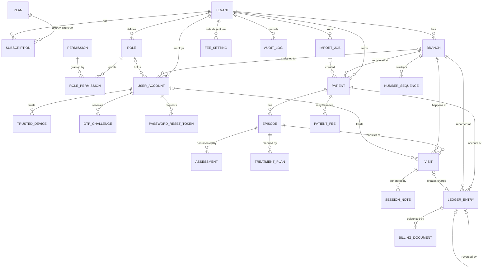
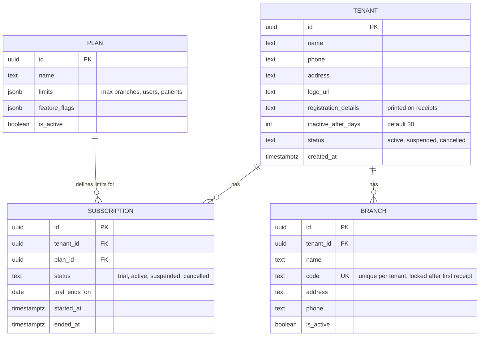
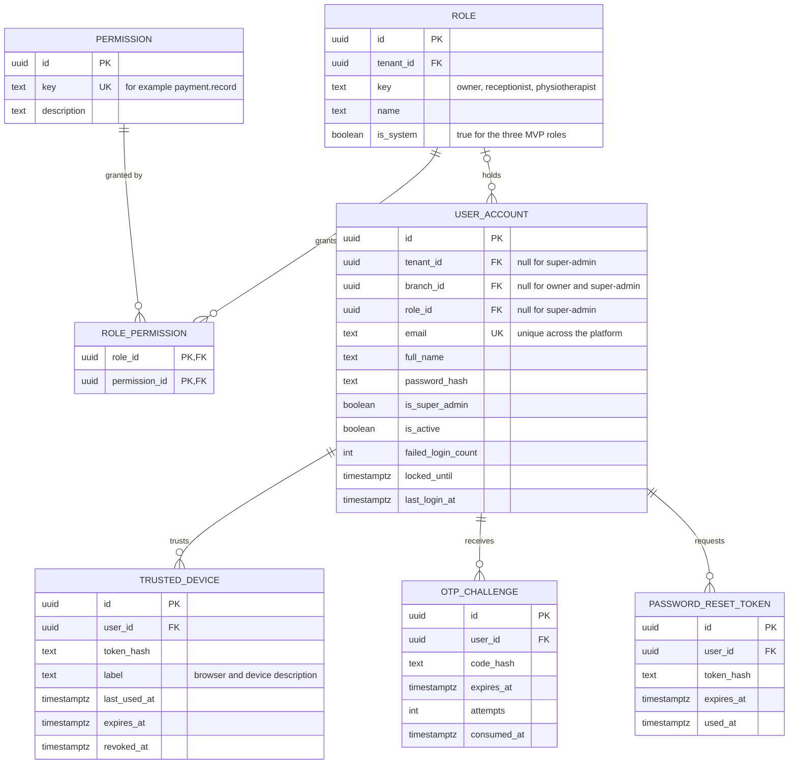
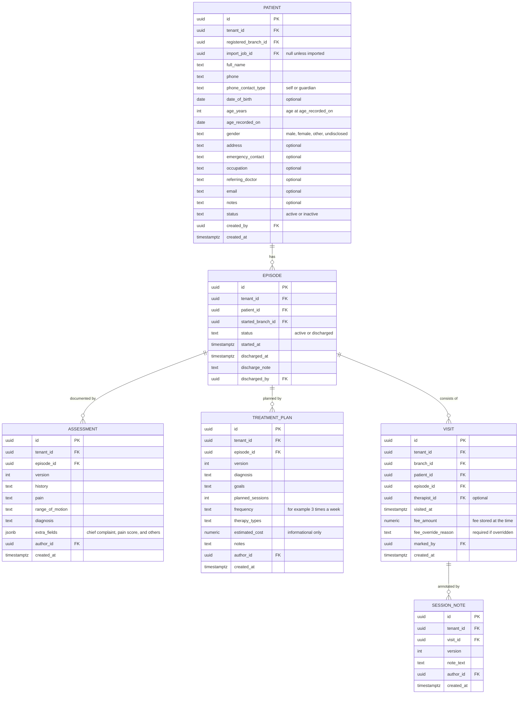
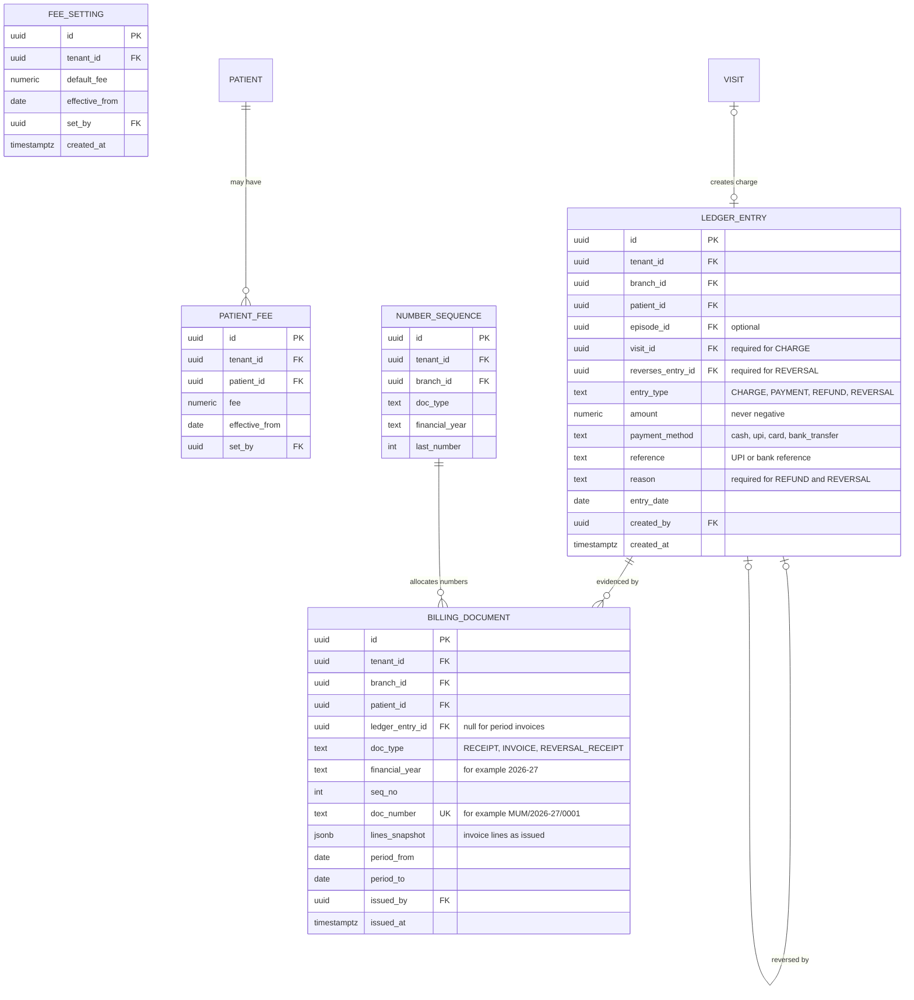
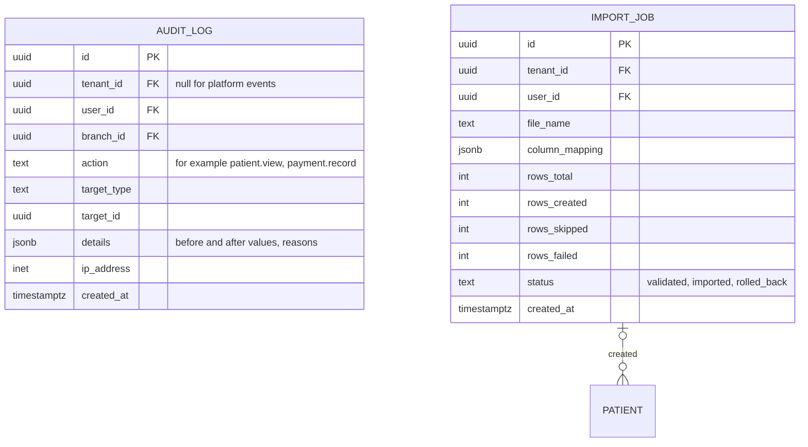

# Physiotherapy Clinic Management Software — Database ER Diagram

| | |
|---|---|
| **Version** | 1.0 |
| **Date** | 2026-10-26 |
| **Based on** | [PRD.md](PRD.md) v1.0, section 15 (Data Requirements) |
| **Target database** | PostgreSQL |
| **Status** | Draft for review before schema design and migrations |

This document turns the PRD's data requirements into a database design. It does not contain SQL or application code. Where a design choice goes beyond what the PRD states, it is marked **Rec** (recommendation) and listed in section 7 so you can approve or change it.

## 1. Conventions

| Topic | Convention |
|---|---|
| Primary keys | `uuid` for every table, generated by the application or database |
| Tenant column | Every tenant-owned table has `tenant_id`. Every query filters by it (PRD SEC-001) |
| Money | `numeric(12,2)` in INR. Never floating point (NFR-009) |
| Timestamps | `timestamptz`, stored in UTC and shown in India Standard Time |
| Dates | `date` for calendar dates (financial year is derived, April to March) |
| Names | `snake_case` tables and columns. The user table is `user_account` because `user` is a reserved word in PostgreSQL |
| Deletes | No hard deletes of clinical or financial data. Use status flags, versions, and reversal entries (PRD Q25) |
| Append-only tables | `ledger_entry`, `billing_document`, `audit_log`, `assessment`, `treatment_plan`, `session_note`. The application database user gets INSERT and SELECT only (PRD SEC-008) |
| Enums | Stored as text with CHECK constraints (easier to change than native enum types) |

Release tags: **R1** = Pilot, **R2** = Full MVP (PRD section 25).

## 2. Overview diagram

Entities and relationships only. Attributes are in the domain diagrams below.

## 3. Domain diagrams

### 3.1 Platform, tenancy, and subscriptions

PRD: TEN-001, TEN-002, ADM-001, SUB-001 (R1 minimal, R2 full).

### 3.2 Users, roles, permissions, and login security

PRD: AUTH-001 to AUTH-004, USR-001, USR-002.

`ROLE` is per tenant so each owner can edit their own role permissions. The `PERMISSION` catalogue is global and fixed by the product. Custom roles in a later phase need only new `ROLE` rows with `is_system = false`, so no schema change is required.

### 3.3 Patients and clinical records

PRD: PAT-001 to PAT-005, CLN-001 to CLN-004, VIS-001 to VIS-003.

Notes:

- `PATIENT` has no branch ownership. `registered_branch_id` records where the patient was first registered. Every branch's staff can open the patient (PRD Q23, Q28).
- `ASSESSMENT`, `TREATMENT_PLAN`, and `SESSION_NOTE` are **versioned**. An edit inserts a new row with `version + 1`. The latest version is the current one, and old versions stay viewable.
- `VISIT.patient_id` repeats `EPISODE.patient_id` so the "today's visits" list and search avoid a join. A composite foreign key keeps the two consistent (section 5).
- `age_years` with `age_recorded_on` lets the app show a current age even when only an age was entered. If `date_of_birth` is given, the app computes age from it.

### 3.4 Billing: fees, ledger, and documents

PRD: BILL-001 to BILL-008, REP-001 to REP-003.

### 3.5 Audit and import

PRD: AUD-001, IMP-001 (R2), EXP-001 (R2).

## 4. The ledger: how balances work

The patient's account is the sum of ledger entries. Amounts are stored as positive numbers, and the **entry type** decides the direction.

| Entry type | Created by | Effect on patient balance | Required fields |
|---|---|---|---|
| CHARGE | Marking attendance (one per visit) | Increases dues | `visit_id`, amount equals the visit's `fee_amount` |
| PAYMENT | Recording a payment | Reduces dues, or creates advance credit | `payment_method`, optionally `reference` |
| REFUND | Refunding advance credit | Reduces credit (moves balance toward zero) | `payment_method`, `reason` |
| REVERSAL | Correcting a mistake | Exactly cancels the effect of the entry it reverses | `reverses_entry_id`, `reason` |

**Balance** = sum of CHARGE + REFUND − PAYMENT, plus the cancelling effect of each REVERSAL. A positive result means dues. A negative result means advance credit.

**Session count for an episode** = number of its visits whose CHARGE has no reversal.

**Worked example**

| # | Entry | Amount | Running balance |
|---|---|---|---|
| 1 | CHARGE (visit 1) | 500 | 500 due |
| 2 | CHARGE (visit 2) | 500 | 1,000 due |
| 3 | PAYMENT (UPI) | 2,500 | 1,500 advance credit |
| 4 | CHARGE (visit 3, marked by mistake) | 500 | 1,000 advance credit |
| 5 | REVERSAL of entry 4 | 500 | 1,500 advance credit |
| 6 | REFUND (cash) | 1,500 | 0 |

Entry 4 stays in the table with its reversal (entry 5) linked to it. Visit 3 no longer counts as a session.

## 5. Constraints and indexes (Rec unless noted)

### 5.1 Integrity rules

| ID | Rule | Reason |
|---|---|---|
| CON-01 | `ledger_entry.amount >= 0`. `PAYMENT` and `REFUND` amounts must be `> 0`. `CHARGE` may be `0` | Zero-fee visits still need a charge row so the session counts |
| CON-02 | `CHARGE` requires `visit_id`. At most one non-reversed `CHARGE` per visit (unique on `visit_id` where `entry_type = 'CHARGE'`) | One visit, one charge |
| CON-03 | `REVERSAL` requires `reverses_entry_id` and `reason`. `reverses_entry_id` is unique, so an entry is reversed only once | PRD BR-BILL-15 |
| CON-04 | A `REVERSAL` cannot reverse another `REVERSAL` | Keeps the trail simple |
| CON-05 | `PAYMENT` and `REFUND` require `payment_method` in (`cash`, `upi`, `card`, `bank_transfer`). `REFUND` and `REVERSAL` require `reason` | PRD Q17, Q26, Q25 |
| CON-06 | A refund cannot exceed the patient's advance credit at the time. Checked in the same transaction as the insert | PRD BR-BILL-12 |
| CON-07 | `visit.fee_override_reason` is required when `visit.fee_amount` differs from the applicable fee | PRD BR-BILL-1, BILL-001 |
| CON-08 | `unique (branch_id, doc_type, financial_year, seq_no)` on `billing_document`, and `unique (doc_number)` per tenant | No duplicate receipt numbers |
| CON-09 | `unique (branch_id, doc_type, financial_year)` on `number_sequence` | One counter per series |
| CON-10 | `branch.code` is unique within the tenant and cannot change after the first `billing_document` exists for the branch | PRD BR-TEN-2 |
| CON-11 | One **active** episode per patient: partial unique index on `episode (patient_id) where status = 'active'` | PRD BR-CLN-2 |
| CON-12 | `unique (assessment.episode_id, version)`, same for `treatment_plan` and `session_note (visit_id, version)` | Version integrity |
| CON-13 | `user_account.email` is unique case-insensitively across the whole platform | Login uses email only, with no clinic picker (see DD-1) |
| CON-14 | A tenant must keep at least one active owner. Enforced in the application | PRD USR-001 |
| CON-15 | Only the three MVP role keys are created by the product. `role.key` is unique per tenant | PRD Q8 |

### 5.2 Tenant isolation

- **Composite foreign keys (Rec).** Parent tables expose `unique (tenant_id, id)`. Child tables reference `(tenant_id, parent_id)`. This makes it impossible to link, for example, a visit of clinic A to a patient of clinic B, even if the application has a bug.
- **Row-level security (Rec, to be evaluated).** Enable PostgreSQL row-level security with a `tenant_id` policy as a second safeguard behind the application filter (PRD SEC-001, R-8).
- **Super-admin.** Platform tables (`plan`, `tenant`, `subscription`) are visible to the super-admin. Tenant data is not, unless OQ-10 is later decided otherwise.

### 5.3 Indexes for the main screens

| Screen or action | Index |
|---|---|
| Patient search by phone | `patient (tenant_id, phone)` |
| Patient search by name | `patient (tenant_id, lower(full_name))` plus a trigram index (`pg_trgm`) for partial matches |
| Today's visits (S-03) | `visit (tenant_id, branch_id, visited_at desc)` |
| Patient visit history | `visit (patient_id, visited_at desc)` |
| Patient balance (profile, dues warning) | `ledger_entry (patient_id, created_at)` |
| Collections by day, branch, method | `ledger_entry (tenant_id, branch_id, entry_date, entry_type)` |
| Inactive-patient list | `visit (episode_id, visited_at desc)` with the active-episode partial index |
| Audit log viewer | `audit_log (tenant_id, created_at desc)` and `(tenant_id, target_type, target_id)` |
| Login | `user_account (lower(email))` |

## 6. Receipt numbering, step by step

Numbers must have no duplicates and no gaps from failed saves (PRD BR-BILL-17, BR-BILL-18).

1. Start one database transaction.
2. Insert the `ledger_entry` (for example a PAYMENT).
3. Work out the financial year from the entry date in India time: April to March, for example `2026-27`.
4. Lock and increment the counter for `(branch, doc_type, financial_year)` in `number_sequence`, creating it on first use at `0`, and read the new number.
5. Insert the `billing_document` with `doc_number` such as `MUM/2026-27/0001` (branch code, financial year, four-digit sequence).
6. Commit. If anything fails, everything rolls back, including the number, so no gap appears.

A reversal of a payment follows the same steps with `doc_type = REVERSAL_RECEIPT`. The original number is never reused.

## 7. Design decisions that go beyond the PRD

Please approve or change these.

| ID | Decision | Why | Source |
|---|---|---|---|
| DD-1 | Email is unique across the whole platform | Login uses email and password with no clinic selector. A person working at two clinics would need two emails | Rec |
| DD-2 | Zero-fee visits still create a `CHARGE` of 0 | The session count and audit trail stay uniform; a reason is required | Rec |
| DD-3 | `VISIT` has no stored status. "Reversed" is derived from its charge having a reversal | Avoids updating rows; keeps visit and ledger from disagreeing | Rec |
| DD-4 | Receipts and invoices share one table, `BILLING_DOCUMENT`, with a document type | Same numbering mechanism; fewer tables | Rec |
| DD-5 | Invoices store a snapshot of their lines (`lines_snapshot`) | A later reversal must not silently change an invoice that was already issued | Rec |
| DD-6 | Age is stored as `age_years` plus the date it was recorded, with optional date of birth | PRD Q10: you chose age, and the PRD notes date of birth is more accurate | Rec |
| DD-7 | `PATIENT_FEE` is a small separate table with an effective date | PRD BILL-001 (patient-level fee); keeps the history | Rec |
| DD-8 | `OTP_CHALLENGE` and `PASSWORD_RESET_TOKEN` store only hashes, never the code or token | Security: a database leak does not expose live codes | Rec |
| DD-9 | Payments are not linked to specific visits. They apply to the patient account as a whole | PRD assumption A-8 / OQ-9. A link table can be added later if reports need it | A |
| DD-10 | `BILLING_DOCUMENT` allows a null `ledger_entry_id` only for period invoices | Invoices on request cover many entries | Rec |

### Differences from PRD section 15

The PRD's entity list stays valid. This design refines it as follows:

- `Receipt` and `Invoice` become one table, `BILLING_DOCUMENT` (DD-4).
- `Role`, `Permission`, and `RolePermission` become three tables.
- `OTP_CHALLENGE`, `PASSWORD_RESET_TOKEN`, and `PATIENT_FEE` are added.
- `Visit.status` is removed and derived (DD-3).

## 8. Requirement coverage

| PRD requirement | Tables |
|---|---|
| AUTH-001 to AUTH-004 | `user_account`, `trusted_device`, `otp_challenge`, `password_reset_token` |
| TEN-001, TEN-002 | `tenant`, `branch` |
| USR-001, USR-002 | `user_account`, `role`, `permission`, `role_permission` |
| PAT-001 to PAT-005 | `patient` |
| CLN-001 to CLN-004 | `episode`, `assessment`, `treatment_plan` |
| VIS-001 to VIS-003 | `visit`, `session_note` |
| BILL-001 | `fee_setting`, `patient_fee`, `visit` |
| BILL-002 to BILL-005, BILL-008 | `ledger_entry` |
| BILL-006, BILL-007 | `billing_document`, `number_sequence` |
| REP-001 to REP-003 | Read-only queries on `visit`, `ledger_entry`, `patient`, `branch` |
| IMP-001, EXP-001 | `import_job`, `patient.import_job_id` |
| ADM-001, SUB-001 | `tenant`, `plan`, `subscription` |
| AUD-001 | `audit_log` |
| INA-001 | `tenant.inactive_after_days`, `visit`, `episode` |

## 9. Later phases: how the design extends

These are not in the MVP. The design leaves room for them without reworking existing tables.

| Later feature | Likely addition |
|---|---|
| Appointment booking and calendar | New `appointment` table. A visit may optionally link to an appointment |
| Therapist availability and leave | `therapist_schedule`, `leave` tables |
| Patient documents | `patient_document` table with file storage references |
| Progress tracking | Structured measurements linked to visits (for example `outcome_measure`) |
| Exercise library | `exercise`, `exercise_prescription` tables |
| Expense tracking | `expense` table by branch |
| Fixed packages | `package` and `package_purchase` tables, with ledger entries referencing them |
| Custom roles | New `role` rows with `is_system = false` |
| Subscription billing | `subscription_invoice`, `subscription_payment` tables |
| WhatsApp/SMS | `message_template`, `message_log` tables |

## 10. Open items

- **OQ-9:** whether reports must allocate payments to specific visits (affects DD-9).
- **OQ-6:** retention period and cancelled-tenant data handling (affects archiving and deletion design).
- **OQ-10:** super-admin access to tenant data (affects row-level security policy).
- Choose and confirm DD-1 to DD-10 above.
- Legal review of data location (PRD REG-2) before any real patient data is stored.
